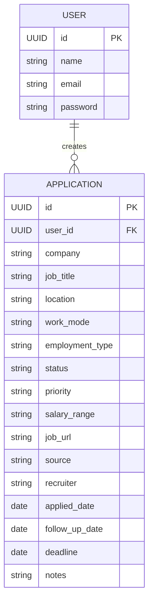

# JobTrack

> A production-oriented full-stack job application tracking platform built with Java, Spring Boot, React, and PostgreSQL.

JobTrack is a full-stack application designed to help developers manage their job search from application to offer.

Instead of maintaining applications across spreadsheets, browser tabs, notes, and emails, JobTrack provides a centralized workspace for tracking applications, monitoring progress, managing follow-ups, and understanding job-search performance.

## Live Demo

**Frontend:**  
https://job-track-frontend-iota.vercel.app/

**Backend API:**  
https://job-tracker-backend-ft0y.onrender.com

**Repository:**  
https://github.com/zeeshanverse/job-tracker

---

## Why JobTrack?

Job searching creates a surprisingly large amount of information:

- Which companies have I applied to?
- What position did I apply for?
- When did I apply?
- Which applications are still active?
- When should I follow up?
- Which applications reached the interview stage?
- Which sources produce the most responses?
- What is my interview conversion rate?

JobTrack is designed to answer these questions from one centralized dashboard.

---

# Core Features

## Authentication & Security

- User registration and login
- JWT-based authentication
- BCrypt password hashing
- Protected REST endpoints
- User-specific application data
- Stateless authentication
- Request validation
- Database-level constraints
- Environment-based configuration

## Application Management

Create and manage job applications with information such as:

- Company
- Job title
- Location
- Work mode
- Employment type
- Application status
- Priority
- Salary range
- Job posting URL
- Application source
- Recruiter information
- Applied date
- Follow-up date
- Deadline
- Notes

## Application Pipeline

Applications can move through a structured workflow:

```text
SAVED
  │
  ▼
APPLIED
  │
  ▼
SCREENING
  │
  ▼
INTERVIEW
  │
  ▼
OFFER
```

Applications can also transition to terminal states such as:

```text
REJECTED
WITHDRAWN
GHOSTED
```

## Dashboard

The dashboard provides an overview of the job search including:

- Total applications
- Active applications
- Interviews
- Offers
- Rejections
- Applications by status
- Recent applications
- Follow-up opportunities

## Search & Filtering

Applications can be searched and filtered by:

- Company
- Position
- Status
- Priority
- Work mode
- Application source

---

# Architecture

JobTrack follows a separated full-stack architecture.

```text
                         ┌──────────────────────┐
                         │       Browser        │
                         └──────────┬───────────┘
                                    │
                                    ▼
                         ┌──────────────────────┐
                         │   React + TypeScript │
                         │       Frontend       │
                         └──────────┬───────────┘
                                    │
                              REST / JSON
                                    │
                                    ▼
                         ┌──────────────────────┐
                         │     Spring Boot      │
                         │       Backend        │
                         └──────────┬───────────┘
                                    │
                    ┌───────────────┼────────────────┐
                    │               │                │
                    ▼               ▼                ▼
             ┌────────────┐ ┌──────────────┐ ┌──────────────┐
             │ Spring Web │ │Spring Security│ │ Spring Data │
             │    REST    │ │     + JWT     │ │     JPA     │
             └────────────┘ └──────────────┘ └──────┬───────┘
                                                     │
                                                     ▼
                                            ┌────────────────┐
                                            │   PostgreSQL   │
                                            └────────────────┘
```

The frontend communicates with the backend through REST APIs. Database access remains inside the backend layer.

---

# Database ER Diagram

At the domain level, JobTrack centers around users and their job applications.



### Relationship

```text
USER
  │
  │ 1
  │
  │ creates
  │
  │ N
  ▼
APPLICATION
```

A user can create and manage multiple job applications, while each application belongs to its authenticated user.

This relationship is also important for application-level data isolation: authenticated users should only be able to access applications belonging to their own account.

---

# Technology Stack

## Backend

- Java 21
- Spring Boot
- Spring Web
- Spring Security
- JWT
- Spring Data JPA
- Hibernate
- Bean Validation
- Flyway
- Maven
- PostgreSQL
- H2 for local development/testing

## Frontend

- React
- TypeScript
- Vite
- React Router
- Modern CSS

## Infrastructure

- Docker
- Docker Compose
- PostgreSQL
- Vercel
- Render

---

# API

The backend exposes REST endpoints for authentication, applications, and dashboard data.

## Authentication

```text
POST   /api/auth/register
POST   /api/auth/login
```

## Applications

```text
GET    /api/applications
POST   /api/applications

GET    /api/applications/{id}
PUT    /api/applications/{id}
DELETE /api/applications/{id}
```

## Dashboard

```text
GET    /api/dashboard
```

Protected endpoints require a valid JWT.

---

# Security

Security is treated as a core part of the application rather than an afterthought.

JobTrack implements:

- BCrypt password hashing
- JWT authentication
- Protected API endpoints
- User-level data isolation
- Stateless authentication
- Request validation
- Database constraints
- Environment-based configuration

A user can only access applications belonging to that authenticated account.

---

# Deployment Architecture

JobTrack is deployed using a separate frontend and backend architecture.

```text
                       INTERNET
                           │
                           ▼
                 ┌───────────────────┐
                 │      Vercel       │
                 │ React + TypeScript │
                 └─────────┬─────────┘
                           │
                       HTTPS / REST
                           │
                           ▼
                 ┌───────────────────┐
                 │      Render       │
                 │   Spring Boot    │
                 │      Backend     │
                 └─────────┬─────────┘
                           │
                           ▼
                 ┌───────────────────┐
                 │    PostgreSQL     │
                 │    Persistence    │
                 └───────────────────┘
```

### Deployment

| Component | Platform |
|---|---|
| Frontend | Vercel |
| Backend | Render |
| Database | PostgreSQL |
| API communication | REST / JSON |
| Transport | HTTPS |

---

# Project Structure

```text
JobTrack/
│
├── backend/
│   ├── src/
│   │   ├── main/
│   │   │   ├── java/
│   │   │   └── resources/
│   │   └── test/
│   │
│   ├── pom.xml
│   └── Dockerfile
│
├── frontend/
│   ├── src/
│   │   ├── components/
│   │   ├── pages/
│   │   ├── services/
│   │   └── ...
│   │
│   ├── package.json
│   └── Dockerfile
│
├── docs/
│
├── docker-compose.yml
└── README.md
```

---

# Running Locally

## Requirements

Install:

- Java 21+
- Maven 3.9+
- Node.js 20+
- npm
- Docker Desktop (optional)

---

## Start the Backend

```bash
cd backend
mvn spring-boot:run
```

The API will be available at:

```text
http://localhost:8080
```

Health check:

```text
http://localhost:8080/actuator/health
```

---

## Start the Frontend

Open another terminal:

```bash
cd frontend
npm install
npm run dev
```

Open:

```text
http://localhost:5173
```

---

# Docker

JobTrack can also be started using Docker Compose:

```bash
docker compose up --build
```

To stop the services:

```bash
docker compose down
```

To remove the database volume as well:

```bash
docker compose down -v
```

---

# Engineering Focus

JobTrack is designed to demonstrate practical software-engineering concepts rather than simply CRUD operations.

Key engineering areas include:

- Layered backend architecture
- REST API design
- Authentication and authorization
- JWT-based security
- Database modelling
- JPA/Hibernate persistence
- Request validation
- Exception handling
- User-level data isolation
- Environment-based configuration
- Database migrations
- Containerization
- Frontend/backend separation
- Cloud deployment

---

# Roadmap

The core JobTrack platform is complete and deployed. Future iterations can extend the platform with advanced tracking, analytics and AI-assisted functionality.

## Phase 1 — Core Platform

- [x] Authentication
- [x] Application CRUD
- [x] Status management
- [x] Dashboard
- [x] Search
- [x] Filtering
- [x] Database persistence
- [x] Docker support

## Phase 2 — Advanced Tracking

- [ ] Kanban pipeline
- [ ] Application timeline
- [ ] Interview management
- [ ] Follow-up reminders
- [ ] Activity history
- [ ] Pagination and advanced sorting
- [ ] CSV import/export

## Phase 3 — Analytics

- [ ] Application conversion rate
- [ ] Interview conversion rate
- [ ] Offer conversion rate
- [ ] Application-source analytics
- [ ] Monthly job-search analytics

## Phase 4 — AI Features

- [ ] Job description analysis
- [ ] Resume-to-job matching
- [ ] Skill-gap analysis
- [ ] AI-generated application insights
- [ ] Job-specific interview preparation

## Phase 5 — Platform Improvements

- [ ] Production monitoring
- [ ] CI/CD pipeline
- [ ] Automated integration testing
- [ ] Advanced observability
- [ ] Performance optimization

---

# Project Status

**Completed · Deployed**

JobTrack is a completed portfolio-grade full-stack Java application with a React frontend, Spring Boot REST backend and PostgreSQL persistence.

### Live Application

https://job-track-frontend-iota.vercel.app/

### Backend

https://job-tracker-backend-ft0y.onrender.com

### Source Code

https://github.com/zeeshanverse/job-tracker

---

# What This Project Demonstrates

JobTrack demonstrates the ability to build and deploy a complete full-stack application around a practical real-world workflow.

The project brings together:

```text
Java
  +
Spring Boot
  +
Spring Security / JWT
  +
REST APIs
  +
React / TypeScript
  +
PostgreSQL
  +
JPA / Hibernate
  +
Docker
  +
Cloud Deployment
```

The result is a deployed job-search management platform rather than a standalone frontend or a simple CRUD demonstration.